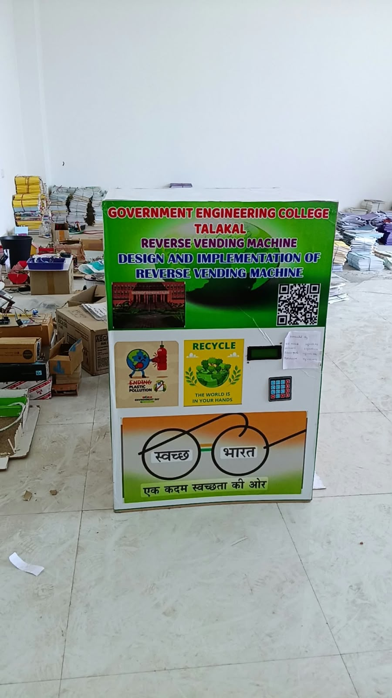
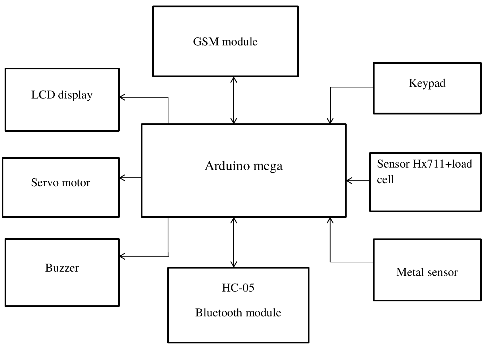
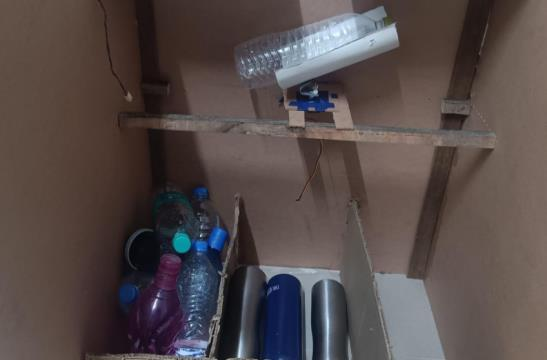
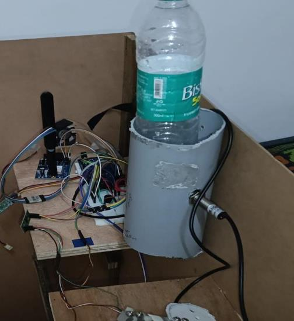
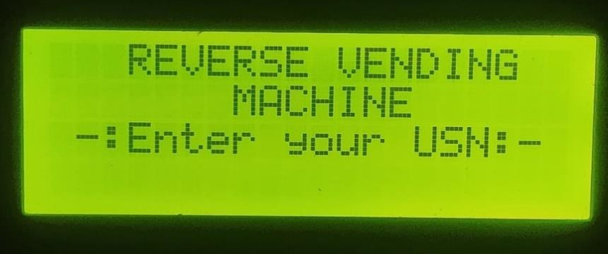
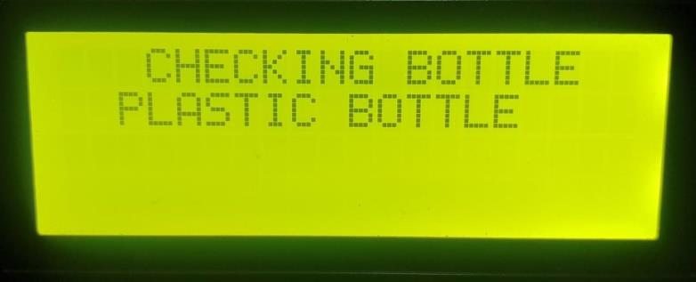
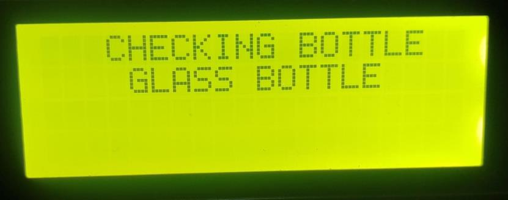
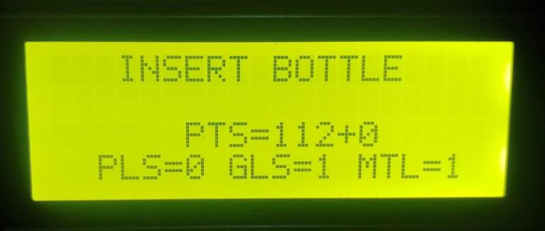
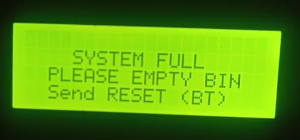
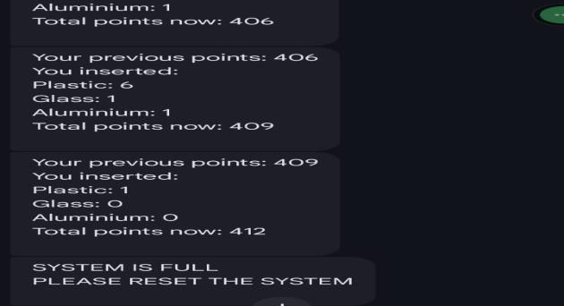

# Reverse Vending Machine (Arduino Mega)

A smart recycling machine that identifies the user by USN, automatically segregates **plastic, metal and glass** bottles, awards reward points, and sends SMS notifications through a GSM module. Built for a college campus, so that points can support students' cleanliness (NSS) activities.

> Final-year ECE major project (team of 4), Government Engineering College, Talakal, Koppal (VTU).
> **My contribution:** [write 2-3 lines about the parts you personally did, e.g. Arduino programming, sensor interfacing, GSM/SMS module]

## Problem
Improper disposal of plastic, metal and glass bottles is a growing waste problem, and ordinary bins neither sort waste nor give people a reason to recycle. This machine sorts bottles automatically and rewards each user for what they deposit.

## Features
- User login with USN entered on a 4x4 keypad (users are stored in the Arduino EEPROM)
- Bottle classification: an inductive metal sensor detects metal bottles, and a load cell (HX711) separates plastic from glass by weight
- Two servo motors: one drops the bottle, the other swings the flap to the plastic, metal or glass bin
- Reward points per bottle type, with live counts shown on a 20x4 I2C LCD
- Buzzer feedback on every accepted bottle
- SMS after each deposit through a GSM 4G module, showing previous points, bottles inserted and the new total
- Bluetooth admin panel (HC-05): ADD USER, DELETE USER and LIST commands manage users from a phone
- Machine-full detection with an LCD message and an SMS alert, cleared by a RESET command over Bluetooth

## Block diagram

## Hardware used
| Component | Purpose |
|---|---|
| Arduino Mega 2560 | Main controller |
| Load cell + HX711 amplifier | Measures bottle weight (plastic vs glass) |
| Inductive proximity (metal) sensor | Detects metal bottles |
| 2 x servo motors | Bottle drop and bin-selector flap |
| 20x4 LCD (I2C) | Instructions, counts and points |
| 4x4 keypad | USN entry |
| Buzzer | Audio feedback |
| GSM 4G module | SMS notifications (AT commands over UART) |
| HC-05 Bluetooth module | Wireless user management and reset |

## How it works
1. The LCD asks the user to enter their USN on the keypad (# confirms, * deletes a digit).
2. The USN is checked against the users stored in EEPROM. An invalid USN shows "Invalid USN!" and asks again.
3. After a valid login the LCD greets the user and shows their previous points.
4. When a bottle is inserted, the machine checks the metal sensor for about 2 seconds.
5. If metal is detected it is counted as a metal bottle (5 points). Otherwise the load cell weight decides: lighter bottles are plastic (3 points) and heavier ones are glass (4 points).
6. The selector servo turns to the matching bin and the drop servo releases the bottle.
7. Points are added and saved to EEPROM, and the LCD shows the running plastic, glass and metal counts.
8. An SMS with the previous points, bottles inserted and total points is sent to the user's mobile number.
9. When the bins are full, the LCD shows "SYSTEM FULL" and an SMS alert is sent. The operator empties the bins and sends RESET over Bluetooth.

## Test results
Each material was tested with 50 bottles.

| Material | Bottles tested | Correctly sorted | Accuracy |
|---|---|---|---|
| Plastic | 50 | 45 | 90% |
| Aluminium / metal | 50 | 50 | 100% |
| Glass | 50 | 40 | 80% |

Glass and plastic are separated only by weight, so light glass bottles or heavy plastic bottles can be misclassified.

## Software
- Embedded C/C++ in the Arduino IDE
- Main code: `reverse_vending_machine.ino`
- Libraries: Wire, LiquidCrystal_I2C, HX711, Keypad, EEPROM, Servo

## Setup
1. Wire the components to the Arduino Mega as shown in the block diagram.
2. Install the libraries above from the Arduino IDE Library Manager.
3. Open `reverse_vending_machine.ino` and select Tools > Board > Arduino Mega 2560 and the correct port.
4. Calibrate the load cell (calibration_factor) and the plastic/glass weight threshold for your bottles.
5. Upload the code. Use the Arduino Bluetooth app to send ADD USER and register users.

## Limitations and future improvements
- Weight-only plastic/glass separation, so add image processing or AI object recognition for damaged or mixed bottles
- Add a GPS module so an SMS alert for a full machine carries the machine's location
- Build a mobile app to view points and redeem rewards, with cloud monitoring across machines
- Solar power, and support for more materials such as paper and e-waste
- Replace the breadboard wiring with a custom PCB designed in KiCad.

## Authors
Team project. Bibi Zainab – [LinkedIn](https://www.linkedin.com/in/bibi-zainab-dhalayat-929b2b41a) | [GitHub](https://github.com/zk946190-ui)
